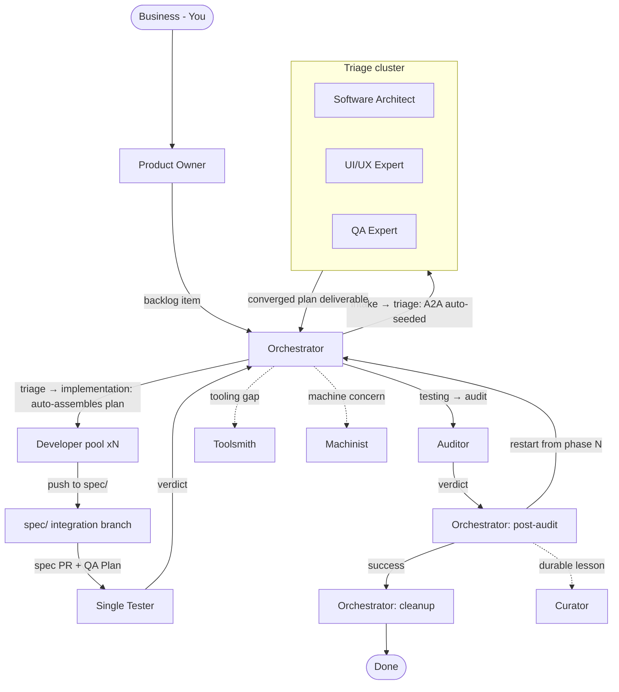

# Agentic Pipeline

A multi-agent workflow with a single orchestrator. The **Orchestrator** runs the pipeline: it dispatches the triage cluster, the developer pool, and the tester, drives the state machine through the phases, and keeps the product docs in sync at the gate. A **triage cluster** plans and decides staffing; a pool of **full-stack developers** executes; a **single tester** runs the QA plan; an independent **Auditor** gates every issue and restarts the pipeline from any phase on failure. Supporting the flow are four **specialist roles**: the **Curator** (durable lessons), the **Toolsmith** (skills/scripts), and the **Machinist** (state machine, permissions, measurement). The mechanical orchestration steps are state-machine transition side-effects. GitHub issues and comments are the communication backbone and the log.

---

## Master Diagram

---

## The Roles

| Role | Type | Question | Dispatches | Handles |
|------|------|----------|------------|---------|
| **Business (You)** | Human | What matters? | Product Owner | Goals, priorities, major tradeoffs |
| **Product Owner** | Primary agent | What are we building? | Orchestrator | Backlog, acceptance criteria, prioritization |
| **Orchestrator** | Subagent (×1) | Who does what, when? | Triage cluster, Developer pool, Tester, Auditor | Orchestration, staffing, dependencies, status; dispatches the Auditor; gate doc-sync (product docs → `maint-pr`); cleanup teardown |
| **Triage cluster** | Subagents (×3) | How should we build and prove it? | — | Implementation Plan, Staffing Plan, design, QA Plan |
| **Developer pool** | Subagents (×N) | Can I implement this plan item? | — | Implementation, verification, CI gates |
| **Tester** | Subagent (×1) | Does it work? | — | Executes QA Plan, evidence, verdict |

### Specialist Roles

| Role | Type | Question | Handles |
|------|------|----------|---------|
| **Auditor** | Subagent (×1) | Did it complete? | The independent audit gate — re-derives each AC verdict from the record, decides success or restart (phase + root cause + missed-AC reason) |
| **Curator** | Subagent (×1) | What did we learn? | Durable lessons — playbooks, `### G-` guardrail records, `references.md`, curation (dedup, retirement, effectiveness) |
| **Toolsmith** | Subagent (×1) | What tool is missing? | Reusable capability — skills and scripts; every script ships with its skill and a test |
| **Machinist** | Subagent (×1) | Is the machine sound? | The state machine, the permission/sandbox map, and the measurement instrumentation |

---

## Document Index

| File | Content |
|------|---------|
| [principles.md](principles.md) | The non-negotiable design rules: agents as persons, state-machine context, per-phase Goals, playbook-linked agents, GitHub backbone + log, the independent audit gate |
| [pipeline.md](pipeline.md) | Phase walkthrough: Intake → Triage → Implementation → Testing → Audit → Post-audit → Cleanup → Done |
| [artifacts.md](artifacts.md) | Artifact catalog: every document/object produced, with templates |
| [github.md](github.md) | GitHub conventions: issue templates, labels, branch naming, PR checklist, comment prefixes, automation |
| [staffing.md](staffing.md) | Staffing heuristics, guardrails, SLAs, traceability |
| [state-machine.md](state-machine.md) | **Implemented:** the state-machine skill + script that gives agents phase context and is the single writer; also the metrics collector — per-issue JSONL event log, metric catalog, anti-metrics |
| [pipeline-rationale.md](pipeline-rationale.md) | Why the pipeline is built this way — deterministic state-machine control that injects context to bound stochastic agent behavior, and the audit/improvement feedback loop |
| [agent-definition-guide.md](agent-definition-guide.md) | Anatomy for writing agent `.md` files: identity, structure, length limits, DeepSeek-specific guidance, iteration/eval |
| [agent-skill-guide.md](agent-skill-guide.md) | Anatomy for writing `SKILL.md` files: description-as-router, progressive disclosure, length limits, degrees of freedom, iteration/eval |
| [common-rules.md](common-rules.md) | The cross-cutting rules every agent in the pipeline follows: research discipline, how to use the shared references, citing sources, and behaviour that cuts across phases |
| [permissions.md](permissions.md) | Each agent's deny-by-default sandbox — which commands and edit paths actually work, and the loop-mitigation rules. **Read before acting** |
| [templates/PO-issue-template.md](templates/PO-issue-template.md) | Backlog issue template for the Product Owner: title (Connextra), problem/why, scope, success metrics, 3–5 bullet acceptance criteria (Gherkin only where warranted), INVEST self-check, bug variant |

### Playbooks

Per-agent dispatch briefs — the role's mandate, its phases, its tools, and the artifacts it owes.

| Playbook | Role |
|----------|------|
| [product-owner.md](playbooks/product-owner.md) | Product Owner — intake, backlog, acceptance criteria |
| [orchestrator.md](playbooks/orchestrator.md) | Orchestrator — dispatch, transitions, staffing, blockers, teardown, the gate doc-sync (`maint-pr`) |
| [software-architect.md](playbooks/software-architect.md) | Software Architect — research, domain model, task decomposition, fix plans |
| [ui-ux-expert.md](playbooks/ui-ux-expert.md) | UI/UX Expert — design assets, interaction flows, accessibility |
| [qa-expert.md](playbooks/qa-expert.md) | QA Expert — the QA Plan and the sole authorship of feature test suites |
| [developer.md](playbooks/developer.md) | Developer — implementation, verification, CI gates |
| [tester.md](playbooks/tester.md) | Tester — executes the QA Plan, attaches evidence, posts the verdict |
| [auditor.md](playbooks/auditor.md) | Auditor — the independent audit gate and verdict |
| [curator.md](playbooks/curator.md) | Curator — durable lessons, the guardrail ledger, Class → Lever routing |
| [toolsmith.md](playbooks/toolsmith.md) | Toolsmith — reusable skills and scripts |
| [machinist.md](playbooks/machinist.md) | Machinist — the state machine, permissions/sandbox, measurement |
| [references.md](playbooks/references.md) | The shared, agent-editable knowledge base — every agent may add, edit, and remove references; the Curator owns the `### G-` guardrail records under Known Failure Modes |

### Templates

| Template | Used for |
|----------|----------|
| [triage-plan-template.md](templates/triage-plan-template.md) | The Implementation Plan assembled at the `triage → implementation` transition |
| [Triage-plan-comment-template.md](templates/Triage-plan-comment-template.md) | The `## Triage Plan` comment |
| [Status-comment-template.md](templates/Status-comment-template.md) | The agent-facing `Status` comment (blockers/escalations only) |
| [Development-summary-comment-template.md](templates/Development-summary-comment-template.md) | The `## Development Summary` roll-up comment |
| [Tests-runs-comment-template.md](templates/Tests-runs-comment-template.md) | The `## Tests Runs` verdict comment |
| [Fix-plan-comment-template.md](templates/Fix-plan-comment-template.md) | The machine-posted `## Fix Plan (round N)` comment |
| [Audit-verdict-comment-template.md](templates/Audit-verdict-comment-template.md) | The Auditor's one `## Audit Verdict` comment (verdict + per-AC re-derivation) |
| [Pipeline-improvement-comment-template.md](templates/Pipeline-improvement-comment-template.md) | The Curator's ONE `## Pipeline Improvement` comment |
| [Final-status-comment-template.md](templates/Final-status-comment-template.md) | The `## Final Status` closing comment (outcome + doc-sync + metrics + PRs) |

---

## Phase at a Glance

| Phase | Owner | Goals (definition of done) | Key actions | Artifact produced |
|-------|-------|----------------------------|-------------|-------------------|
| 1. Intake | Product Owner | Confirmed backlog issue with ACs + priority | Clarify → design summary → backlog item | Backlog issue |
| 2. Triage | Triage cluster (orchestrated by Orchestrator) | Complete Implementation Plan covering all requirements | Research → consult UX + QA in parallel → converge → marker → transition auto-assembles plan | Implementation Plan (incl. Staffing Plan) |
| 3. Implementation | Orchestrator (setup) + Developer pool | All plan checklist work pushed to `spec/<N>`, CI green | Staff → dispatch devs → worktree on spec branch → push → spec PR | Implementation Plan checklist, spec/<N> branch |
| 4. Testing | Tester | Verdict posted with evidence; failures re-dispatched | Execute QA Plan → attach evidence → verdict | Test report, verdict comments |
| **Gate** | Auditor | Verdict: success, or restart phase + root cause | Audit from the record → decide → record verdict | Audit verdict |
| 5. Post-audit | Orchestrator | Self-improvement + gate merge ran: the Curator recorded a lesson, the SPEC MAINT PR (`maint/<N>`) opened and merged, product docs synced | Dispatch the Curator + specialists → gate doc-sync → `maint-pr` (force-merge) → `post-audit → cleanup` (success, gated on the merge) or `→ <phase>` (restart) | Curator lesson, merged SPEC MAINT PR |
| 6. Cleanup | Orchestrator | Teardown done, feature labeled `done`, human review | Cleanup → human review | Closed work, final status |
| 7. Done | Orchestrator | Feature `done`, worktrees cleaned, human review | Status updates, human review | Closed work, final status |

---

## Core Conventions

- **Single source of truth:** GitHub issues and comments track every artifact, decision, status, and piece of evidence.
- **Comment prefixes:** one agent-facing prefix — `Status` (blockers/escalations only). Every phase also has ONE structured, authored comment: the plan `## Triage Plan`, each developer's `## Developer <ST-id> — verification`, the tester's `## Tests Runs`, the Auditor's `## Audit Verdict`, the Curator's `## Pipeline Improvement`, and the closing `## Final Status` — every one ending `*Authored by <Agent>*`.
- **Issue model per feature:** one **feature issue** (the single work-tracking artifact). Its `### Sub-issue Decomposition` `- [ ]` lines are the work checklist developers execute on the spec branch — there are **no sub-issues and no tester issue** (`generate-work` was removed).
- **Branch naming:** one **spec integration branch** `spec/<N>` per spec (never deleted — it carries the evidence trail). No per-developer branches: developers work in worktrees **detached at `spec/<N>`'s tip** and push with `git push origin HEAD:spec/<N>`. The product PR is the spec PR (`spec/<N>` → `main`); the post-audit SPEC MAINT PR (`maint/<N>`) is the other.
- **The machine owns the mechanics:** the A2A file is auto-seeded on `intake → triage`; the `triage → implementation` transition auto-assembles the Implementation Plan, persists the QA-seeded test suites, and creates the spec branch. The Orchestrator runs the transitions and dispatches the agents; it never runs these mechanical steps by hand.
- **Independent audit gate + post-audit phase:** the **Auditor** — which neither orchestrated nor built the work — audits every issue after testing from the record; its verdict transitions `audit → post-audit`, the phase where the **Curator** distils a durable lesson and the Orchestrator runs the gate merge. On success the flow goes `post-audit → cleanup`; on failure `post-audit → <phase>` re-dispatches from the chosen phase.

---

## Quick Comparison: What Changed vs the Deprecated Workflow

| Aspect | Deprecated (`workflow_deprecated/`) | Agentic Pipeline |
|--------|-------------------------------------|-------------------|
| Orchestration | Product Owner dispatches Architect; Architect runs Phases 2–4 | Orchestrator owns orchestration end-to-end; the Auditor gates every issue |
| Planning | Software Architect alone (2 consultants) | Triage cluster of 3 parallel planners |
| Staffing | 1 Developer per capsule (Architect decides) | Pool of interchangeable full-stack devs, headcount from Staffing Plan |
| Review | Orchestrator reviews + QA runs e2e | Merging by Orchestrator + single Tester |
| Verification | QA Lead (plan) + QA (execute) | QA Expert (plan + tests in triage) + Tester (execute) |
| Improvement | Orchestrator gate + 3-gate validation | Independent Auditor gate + Curator/Toolsmith/Machinist improvement roles (implemented) |
| Docs | Documentation Keeper agent | Orchestrator (gate doc-sync — product docs in the force-merged SPEC MAINT PR) |
